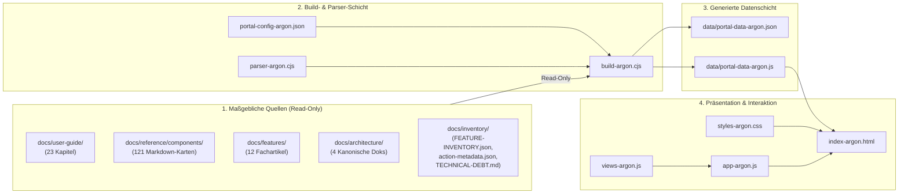

# Architektur & SWE-2-Datenschnittstelle (`ARCHITEKTUR-ARGON.md`)

Dieses Dokument beschreibt die technische Architektur des **GCS Documentation Portals (Argon Edition)** unter `docs/gcs-doc-portal-argon/` sowie die verbindliche Datenschnittstelle für die Zusammenarbeit mit **SWE-2** (KI-Referenzdaten-Agent).

---

## 1. Architektur-Grundsätze (4-Schichten-Trennung)

Das Portal trennt strikt zwischen vier Schichten:



### Warum diese Trennung?
1. **Single Source of Truth:** Keine Markdown-Datei wird manuell dupliziert. Änderungen an Kapiteln, Komponenten-Steckbriefen oder Inventaren fließen über `node docs/gcs-doc-portal-argon/build-argon.cjs` verlustfrei in das Portal ein.
2. **Schutz fremder Agenten-Artefakte:** Weder `docs/inventory/` (SWE-2) noch `docs/handbook-html/` (Argon Phase 1 / Opus) werden vom Build-Skript verändert.
3. **100 % Offlinefähigkeit (`file://`):** Durch die parallele Auslieferung von `data/portal-data-argon.json` (für Tools/KI) und `data/portal-data-argon.js` (`window.GCS_PORTAL_DATA_ARGON`) funktioniert `index-argon.html` direkt per Doppelklick im Windows-Explorer ohne CORS-Fehler.
4. **Einhaltung des 1000-Zeilen-Limits:** Jede Programmcode-Datei (`index-argon.html`, `styles-argon.css`, `app-argon.js`, `views-argon.js`, `build-argon.cjs`, `parser-argon.cjs`) ist modular geschnitten und bleibt deutlich unter 1000 Zeilen.

---

## 2. Automatische Querverlinkung (`parser-argon.cjs`)

Während des Builds wandelt `parser-argon.cjs` nicht nur Markdown-Elemente (Tabellen, Codeblöcke, Checklisten, Callout-Boxen, Sprecher-Drehbücher) in semantisches HTML um, sondern erkennt im gesamten Text automatisch GCS-Bezeichner und verknüpft sie bidirektional:

- **Komponenten-Code-Tokens (`T*`):** z. B. `` `TSprite` ``, `` `TTimer` ``, `` `TGameState` `` → klickbarer Link `#components/TSprite`.
- **Feature-IDs (`FEAT-xxxx`):** z. B. `FEAT-0001` → klickbarer Link `#features/FEAT-0001`.
- **Komponenten-IDs (`COMP-xxxx`):** z. B. `COMP-0097` → klickbarer Link `#components/TSprite`.
- **Technical-Debt-IDs (`TD-xxx`):** z. B. `TD-009` → klickbarer Link `#devref/technical-debt`.
- **Interne Markdown-Links auf Kapitel oder Komponenten:** werden automatisch auf die entsprechenden Portal-Routen (`#handbook/<id>`, `#components/<TName>`) umgeschrieben.

Zusätzlich berechnet `build-argon.cjs` einen **inversen Referenz-Graphen**:
- Jede Komponente kennt alle Handbuch-Kapitel (`usedInChapters[]`) und Features (`relatedFeatures[]`), in denen sie verwendet wird.
- Jedes Feature (`FEAT-0001`…`0012`) listet seine zugehörigen Komponenten (`linkedComponents[]`) und relevanten Handbuch-Kapitel (`linkedChapters[]`).

---

## 3. Zusammenarbeit mit SWE-2: Dokumentierte Datenschnittstelle

SWE-2 entwickelt strukturierte Referenzdaten und JSON-Verträge für KI-Agenten. Damit die Ergebnisse von SWE-2 später ohne Umbau der Portal-Oberfläche integriert werden können, definiert `portal-config-argon.json` eine explizite Datenschnittstelle.

### 3.1 Kanonische Join-Schlüssel (Primary Keys)

Beide Systeme (Argon Portal & SWE-2) verwenden das in `docs/inventory/ID-SCHEME.md` festgelegte ID-Schema:

| Entitätstyp | Kanonischer Schlüssel | Sekundärer Schlüssel | Beispiel |
|---|---|---|---|
| **Komponente** | `id` (`COMP-0001`…`COMP-0128`) | `name` (`T*`) | `COMP-0097` / `TSprite` |
| **System-Feature** | `id` (`FEAT-0001`…`FEAT-0012`) | `category` | `FEAT-0001` (`editor`) |
| **Dokument** | `id` (`DOC-0001`…`DOC-0242`) | `file` (relativer Pfad) | `DOC-0117` / `docs/architecture/overview.md` |
| **Runtime-Action** | `type` (Action-Bezeichner) | — | `navigate_stage`, `calculate`, `property` |
| **Technical Debt** | `id` (`TD-001`…`TD-017`) | — | `TD-009` |

### 3.2 Optionale SWE-2-Overlay-Dateien (`optionalOverlayFiles`)

In `docs/gcs-doc-portal-argon/portal-config-argon.json` sind unter `swe2Integration.optionalOverlayFiles` folgende optionale Pfade vordefiniert:

```json
{
  "swe2Integration": {
    "schemaVersion": "1.0.0",
    "joinKeys": {
      "component": "id (COMP-0001..COMP-0128) | name (T*)",
      "feature": "id (FEAT-0001..FEAT-0012)",
      "document": "id (DOC-0001..DOC-0242) | file (relativer Pfad)",
      "action": "type (aus action-metadata.json)"
    },
    "optionalOverlayFiles": [
      "docs/inventory/ai-agent-reference.json",
      "docs/inventory/component-contracts.json",
      "docs/inventory/swe2-reference-data.json"
    ]
  }
}
```

### 3.3 Verhalten von `build-argon.cjs` bei vorhandenen SWE-2-Daten

1. **Phase 1 (Aktueller Stand):** Solange keine der optionalen Overlay-Dateien existiert, arbeitet `build-argon.cjs` vollständig auf Basis von `FEATURE-INVENTORY.json`, `action-metadata.json`, `TECHNICAL-DEBT.md` und den Markdown-Quellen (`swe2OverlayActive: false`).
2. **Phase 2 (Nach Bereitstellung durch SWE-2):** Sobald SWE-2 eine oder mehrere der genannten JSON-Dateien ablegt, erkennt `build-argon.cjs` diese beim nächsten Lauf automatisch, setzt `meta.swe2OverlayActive = true` und legt die zusätzlichen KI-Vertragsdaten unter `data.swe2Overlays` ab, ohne dass bestehende Portal-Funktionen brechen.

---

## 4. Datenformat von `data/portal-data-argon.json`

Das generierte Portal-Datenobjekt besitzt folgende Top-Level-Struktur:

```json
{
  "meta": {
    "portalId": "gcs-doc-portal-argon",
    "version": "1.0.0",
    "generatedAt": "ISO-8601",
    "swe2Integration": { "...": "..." },
    "swe2OverlayActive": false,
    "counts": {
      "handbookChapters": 23,
      "components": 128,
      "componentCardsMd": 121,
      "componentCategories": 11,
      "features": 12,
      "featureArticles": 12,
      "architectureDocs": 4,
      "devRefDocs": 8,
      "actions": 59,
      "techDebtItems": 17,
      "inventoryDocuments": 242,
      "searchEntries": 484
    }
  },
  "handbook": { "chapters": [ /* 23 Kapitel-Objekte */ ] },
  "components": {
    "categories": [ /* 11 Kategorie-Aggregate */ ],
    "items": [ /* 128 Komponenten-Objekte (COMP-0001..0128) */ ]
  },
  "features": {
    "inventory": [ /* 12 FEAT-Objekte (FEAT-0001..0012) */ ],
    "articles": [ /* 12 aufbereitete Fachartikel aus docs/features/ */ ]
  },
  "architecture": {
    "articles": [ /* 4 kanonische Architektur-Dokumente */ ]
  },
  "devref": {
    "articles": [ /* 8 Entwickler-Referenzdokumente */ ],
    "actions": [ /* 59 Runtime-Actions mit Parametern */ ],
    "techDebt": [ /* 17 strukturierte Technical-Debt-Befunde */ ],
    "documentInventory": [ /* 242 DOC-Einträge */ ]
  },
  "swe2Overlays": {},
  "searchIndex": [ /* Vereinheitlichte Volltext-Sucheinträge über alle 6 Bereiche */ ]
}
```
