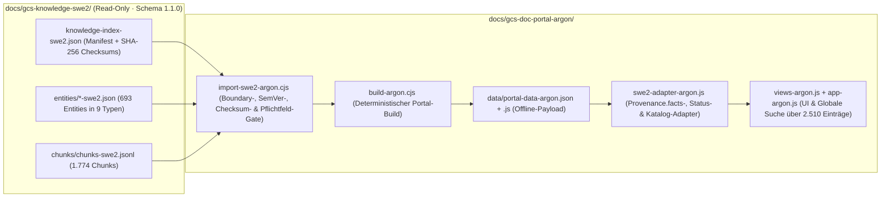

# INTEGRATION-SWE2-ARGON — Dokumentation der SWE-2-Wissensbasis-Integration (Schema 1.1.0)

**Portal-Pfad:** `docs/gcs-doc-portal-argon/`  
**Wissensbasis-Pfad:** `docs/gcs-knowledge-swe2/` (Read-Only, Schema `1.1.0`, Commit `53e3dfb`)  
**Verbindlicher Datenvertrag:** `docs/gcs-knowledge-swe2/SCHNITTSTELLE-ARGON.md`

---

## 1. Architektur & Datenfluss (Schema 1.1.0)

1. **Snapshot-Bindung & Importer-Gate (`import-swe2-argon.cjs`):**
   - Prüft per `resolveWithinKnowledgeBoundary` (`realpathSync`), dass alle Pfade strikt innerhalb von `docs/gcs-knowledge-swe2/` liegen (`A15`).
   - Prüft `manifest.schemaVersion` strikt gegen `/^1\.\d+\.\d+$/` (aktuell `1.1.0`) sowie alle 10 Datei-Prüfsummen in `manifest.checksums` per SHA-256 (`A04`, `A14`).
   - Lädt und validiert alle **693 Entities** in 9 Entity-Typen auf Pflichtfelder (`id`, `kind`, `name`, `status.dev`, `status.test`, `status.doc`, `provenance.confidence`, `provenance.method`, `version.extractedAt`, `version.contentHash`), eindeutige IDs, exakte Manifest-Zähler (`counts.entities`, `counts.byKind`) und 100 % auflösbare `relations` (`0` unauflösbare Relationen).
   - Lädt und validiert alle **1.774 Chunks** aus `chunks/chunks-swe2.jsonl` mit opaken, eindeutigen `chunkId`-Schlüsseln (`<entity>:<docSlug>:<section>[:seq]`, `A05`).
2. **Kanonische Verknüpfung im Build (`build-argon.cjs`):**
   - Übernimmt Komponenten-`properties` kanonisch aus SWE-2 Schema `1.1.0` inklusive `options`, `default`, `source` und `confidence` (ohne unbestätigte Markdown-Tabellenzeilen als technische Properties zu duplizieren, `A06`/`A09`).
   - Übernimmt Komponenten-`events` inklusive `origin` (`own` vs. `inherited`), `declaredIn`, `inheritedFrom`, `conditions` (`isHiddenInRun = false`) und `confidence` (`A07`/`A09`).
   - Übernimmt alle erweiterten Action-Parameterfelder (`defaultValue`, `source`, `options`, `placeholder`, `allowVariableBinding`, `allowFreeText`, `multiline`, `visibleWhen`, `A09`).
   - Maskiert sämtliche dynamischen Fallback-Texte (`escapeHtml`, `A01`).
   - Erzeugt den globalen Suchindex mit **2.510 Einträgen** (`693` kanonische Entity-Basistreffer + `1.774` RAG-Chunks + `43` Fachartikel/Tech-Debt-Einträge, `A02`/`A03`).

---

## 2. Integrierte SWE-2-Entity-Typen & Portal-Zielansichten

| Entity-Typ (`kind`) | Stabiler ID-Bereich | Anzahl | Primäre Portal-Ansicht |
| :--- | :--- | :---: | :--- |
| `component` | `COMP-0001` … `COMP-0128` | **128** | `#components/<COMP-ID\|TName>` |
| `feature` | `FEAT-0001` … `FEAT-0012` | **12** | `#features/<FEAT-ID>` |
| `action-type` | `ACT-0001` … `ACT-0059` | **59** | `#devref/actions?q=<ACT-ID>` |
| `method` | `MTH-0001` … `MTH-0038` | **38** | `#devref/methods?q=<MTH-ID>` |
| `event` | `EVT-0001` … `EVT-0163` | **163** | `#devref/events?q=<EVT-ID>` |
| `schema` | `SCM-0001` … `SCM-0013` | **13** | `#devref/schemas?q=<SCM-ID>` |
| `guide-chapter` | `GUIDE-0001` … `GUIDE-0023` | **23** | `#handbook/<kapitel-id\|GUIDE-ID>` |
| `document` | `DOC-0001` … `DOC-0242` | **242** | `#devref/doc-inventory?q=<DOC-ID>` (bzw. Fachansicht, sofern `missing: false`) |
| `concept` | `CON-0001` … `CON-0015` | **15** | `#devref/schemas?q=<CON-ID>` |
| **Gesamt** | | **693** | **Alle 693 Entities direkt adressierbar & im Suchindex** |

---

## 3. Umsetzung der Kennzeichnungs- und Sicherheitsregeln

- **Keine falsche Confidence-Hochstufung (`A08`):** `verified`, `documented` und `inferred` werden im gesamten Portal strikt getrennt dargestellt. Zusätzlich visualisiert `renderProvenanceFactsBar` auf Detailseiten alle Teil-Confidence-Werte aus `provenance.facts`.
- **Kein optimistischer `status.dev`-Fallback (`§6.3`):** Fehlende `status.dev`-Werte werden im Importer als Vertragsbruch abgewiesen und in der UI über `normalizeDevStatus` als `unbekannt` mit Warnhinweis markiert.
- **Gelöschte Dokumente (`missing: true`):** Alle 12 als `missing: true` markierten Dokumente besitzen `portalHref: null` und werden mit `🗑️ Datei gelöscht` gekennzeichnet.
- **100 % Offlinebetrieb:** `data/portal-data-argon.js` stellt `window.GCS_PORTAL_DATA_ARGON` lokal über `file://` ohne Webserver oder externe CDN-Abhängigkeiten bereit.
