# DV-Konzept: GCS-CMS (Datenverarbeitungskonzept)

---

## 1. Einleitung und Systemarchitektur

Dieses Datenverarbeitungskonzept (DV-Konzept) spezifiziert die technische und funktionale Architektur des **GCS-CMS** (Game Creation Suite Content Management System).

### 1.1 Architekturschichten
1. **UI- & Präsentationsschicht (Stage-Ebene):** Visuelle Komponenten (Buttons, Tabellen, Formulare, Dialoge, Timer), die in den Stages definiert sind.
2. **Steuerungsschicht (Task- & Action-Flow):** Reaktive Tasks, die Ereignisse (Klicks, Timer, Serverantworten) verarbeiten und atomare Actions sequentiell oder bedingt ausführen.
3. **Zustandsschicht (State Management):** Lokale Stage-Variablen und globale Blueprint-Variablen (`Token`, `Busy`, `Status`, `AnmeldeAntwort`, etc.).
4. **Service- & Persistenzschicht (Backend-Services & REST-APIs):** HTTP-Endpunkte (`/api/cms/...`), die Sessions, Rechtematrizen, Entitäten und Raumzustände verwalten.

### 1.2 Interaktionsmuster
Jeder Use Case folgt einem durchgängigen 4-Phasen-Muster:
`[Benutzer-Interaktion] → [UI-Event] → [Task-Sequenz & Guards] → [Action: Property/HTTP/Method] → [State-Update & UI-Reaktion]`

---

## 2. Inhaltsverzeichnis der Use Cases

### Teil A: Spieler- & Kinder-Sitzungen (Front-Office)
- [UC-01: Emoji-PIN Anmeldung & Authentifizierung](#uc-01-emoji-pin-anmeldung--authentifizierung)
- [UC-02: Spielhaus-Galerie & Raum-Präsenztimer](#uc-02-spielhaus-galerie--raum-präsenztimer)
- [UC-03: Spieleauswahl & Spielstart](#uc-03-spieleauswahl--spielstart)
- [UC-04: Spielerprofil, Avatar-Upload & Zugangshilfe](#uc-04-spielerprofil-avatar-upload--zugangshilfe)
- [UC-05: Mein Zimmer – Persönliche Zutrittssteuerung](#uc-05-mein-zimmer--persönliche-zutrittssteuerung)
- [UC-06: Mehrspieler-Lobby & Einladungsversand](#uc-06-mehrspieler-lobby--einladungsversand)
- [UC-07: Mehrspieler-Postfach & Spielbeitritt](#uc-07-mehrspieler-postfach--spielbeitritt)

### Teil B: Eltern & Beobachter (Family Office)
- [UC-08: Zentrale Verwaltungs-Authentifizierung](#uc-08-zentrale-verwaltungs-authentifizierung)
- [UC-09: Eltern-Aktivitätsmonitoring & 2-Stufen-Zeitbudget](#uc-09-eltern-aktivitätsmonitoring--2-stufen-zeitbudget)
- [UC-10: Raum-Puls & Pädagogische Begleitung](#uc-10-raum-puls--pädagogische-begleitung)

### Teil C: Raum-Administration (RaumAdmin)
- [UC-11: Raum-Zutrittsverwaltung](#uc-11-raum-zutrittsverwaltung)
- [UC-12: Raum-Spielekatalog kuratieren](#uc-12-raum-spielekatalog-kuratieren)

### Teil D: Haus-Administration (HouseAdmin)
- [UC-13: Raum-Lebenszyklus & RaumAdmin-Zuweisung](#uc-13-raum-lebenszyklus--raumadmin-zuweisung)
- [UC-14: Raum-Sicherung & Wiederherstellung (Backup/Restore)](#uc-14-raum-sicherung--wiederherstellung-backuprestore)
- [UC-15: Bewohner-Verwaltung & Emoji-PIN-Reset](#uc-15-bewohner-verwaltung--emoji-pin-reset)
- [UC-16: Familien-Verknüpfung (Eltern-Kind-Zuordnung)](#uc-16-familien-verknüpfung-eltern-kind-zuordnung)
- [UC-17: Hausweiter Spielekatalog](#uc-17-hausweiter-spielekatalog)
- [UC-18: Einladungslinks für Eltern & Beobachter](#uc-18-einladungslinks-für-eltern--beobachter)

### Teil E: Plattform-Administration (SuperAdmin)
- [UC-19: Spielhaus-Gründung & Plattformverwaltung](#uc-19-spielhaus-gründung--plattformverwaltung)
- [UC-20: Plattform- und Haus-Admins delegieren](#uc-20-plattform--und-haus-admins-delegieren)
- [UC-21: Spiele-Bibliothek & Paket-Upload](#uc-21-spiele-bibliothek--paket-upload)
- [UC-22: Sandbox-Prüfung, Freigabe-Workflow & Löschung](#uc-22-sandbox-prüfung-freigabe-workflow--löschung)

---
## Teil A: Spieler- & Kinder-Sitzungen (Front-Office)

### UC-01: Emoji-PIN Anmeldung & Authentifizierung
**Beschreibung:** Ein Kind authentifiziert sich ohne Tastatur über eine 4-stellige Folge von Bildsymbolen. Die Eingabe wird visualisiert, geprüft und bei Erfolg eine Benutzersitzung initialisiert.

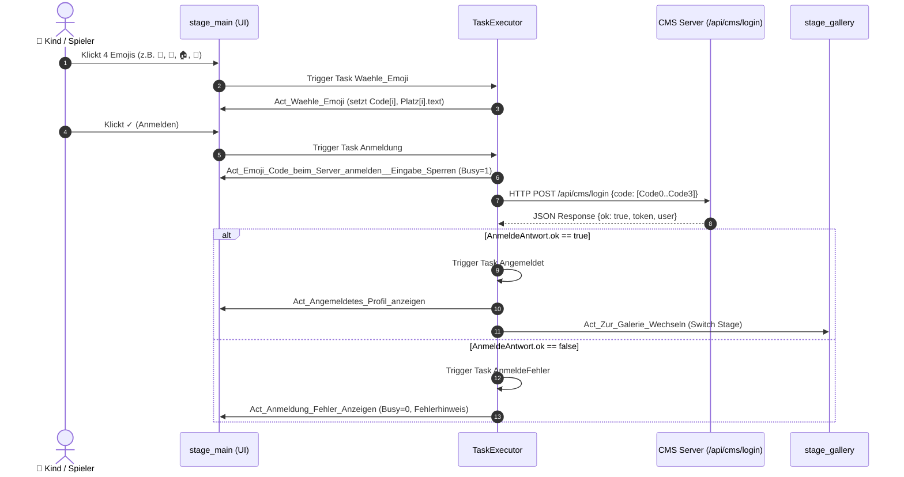

**Beteiligte Tasks & Verzweigungen:**
- `Waehle_dog` (etc.): Triggert bei Klick auf ein Emoji; füllt den nächsten freien Slot (0–3).
- `LoeschenTask`: Triggert bei `⌫`; leert den zuletzt belegten Platz.
- `Anmeldung`: Startet Authentifizierungs-Workflow.
- `Angemeldet`: Folge-Task bei erfolgreicher Rückmeldung (`AnmeldeAntwort.ok == true`).
- `AnmeldeFehler`: Folge-Task bei ungültiger PIN oder Serverfehler.

**Detaillierte Action-Beschreibung:**
- `Act_Emoji_Code_beim_Server_anmelden__Eingabe_Sperren_Und_Warten_Anzeigen` (*Typ: property*):
  - **Aufgabe:** Verhindert Doppeleingaben während der Netzwerkkommunikation und signalisiert Aktivität.
  - **Eingabe:** `Busy = 1`, `Hinweis.text = 'Wird angemeldet …'`.
  - **Auswirkung:** UI-Elemente gesperrt, Spinner/Status aktiv.
- `Act_Emoji_Code_beim_Server_anmelden__Server_EmojiCode_Pruefen_Und_Anmelden` (*Typ: http*):
  - **Aufgabe:** Sendet die vier erfassten Emojis zur Prüfung an das CMS-Backend.
  - **Endpoint / Methode:** `POST /api/cms/login` | **Payload:** `{ code: [Code0, Code1, Code2, Code3] }`.
  - **Ergebnis:** Antwort wird in der Variable `AnmeldeAntwort` abgelegt.
- `Act_Zur_Galerie_Wechseln` (*Typ: switch_stage*): Navigiert nach erfolgreicher Anmeldung zur Spielhaus-Galerie (`stage_gallery`).
- `Act_Anmeldung_Fehler_Anzeigen` (*Typ: property*): Setzt UI bei Fehleingabe zurück (`Busy = 0`, Fehlertext, Plätze geleert).

---

### UC-02: Spielhaus-Galerie & Raum-Präsenztimer
**Beschreibung:** Lädt die für das Kind freigeschalteten Räume und sendet zyklisch einen Anwesenheits-Heartbeat an den Server.

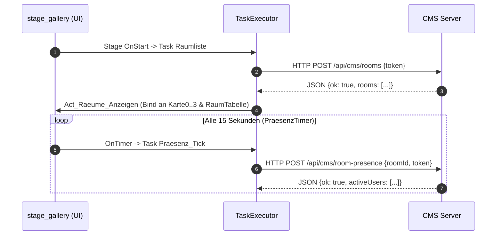

**Detaillierte Action-Beschreibung:**
- `Act_Raeume_Laden` (*Typ: http*): Ruft `POST /api/cms/rooms` auf, speichert Resultat in `RaumAntwort`.
- `Act_Raeume_Darstellen` (*Typ: call_method*): Übergibt das Array `RaumAntwort.rooms` an die visuelle Rasterkomponente `TObjectList`.
- `Act_Praesenz_Senden` (*Typ: http*): Sendet periodisch `POST /api/cms/room-presence` mit aktuellem `roomId`.

---

### UC-03: Spieleauswahl & Spielstart
**Beschreibung:** Der Spieler wählt ein Spiel. Das System prüft serverseitig Raumzugang und verbleibendes Zeitbudget vor der Freigabe.

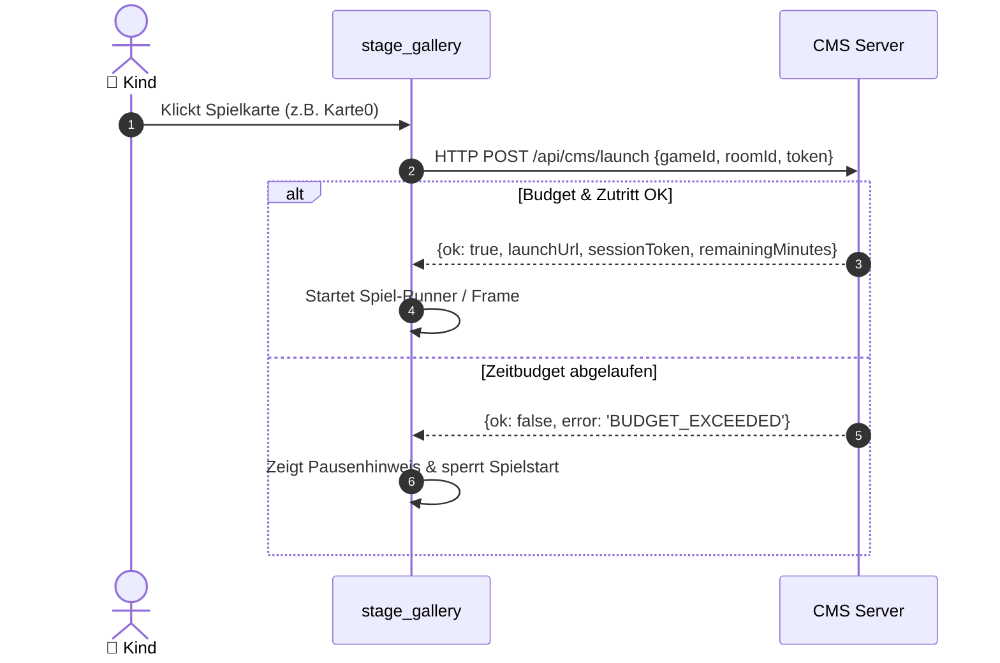

**Detaillierte Action-Beschreibung:**
- `Act_Spiel_Waehlen` (*Typ: property*): Merkt gewählte `gameId` in `SelectedGameId` vor.
- `Act_Launch_Server` (*Typ: http*): Sendet `POST /api/cms/launch` mit `gameId` und `roomId`.
- `Act_Spiel_Instanz_Oeffnen` (*Typ: call_method*): Startet die Spielinstanz im Player.

---

### UC-04: Spielerprofil, Avatar-Upload & Zugangshilfe
**Beschreibung:** Anpassung des Profilnamens, Auswahl aus 8 Tier-Avataren oder eigener Bildupload. Im Problemfall: Alarmsignal an Betreuer.

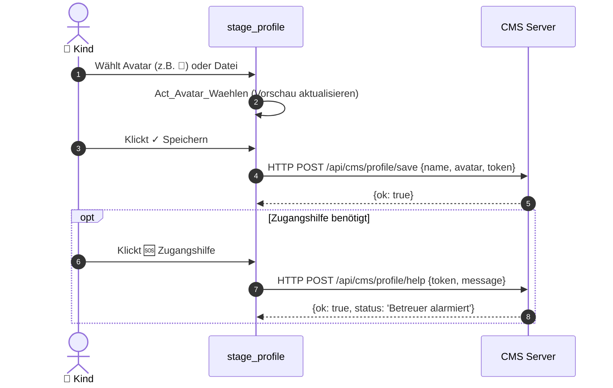

**Detaillierte Action-Beschreibung:**
- `Act_Profil_Laden` (*Typ: http*): Ruft `POST /api/cms/profile/read` ab, um aktuellen Stand anzuzeigen.
- `Act_Avatar_Uebertragen` (*Typ: http / multipart*): Lädt Bilddatei hoch und liefert Asset-URL zurück.
- `Act_Profil_Speichern` (*Typ: http*): Sichert Profiländerungen via `POST /api/cms/profile/save`.
- `Act_Profil_Hilfe_Anfordern` (*Typ: http*): Sendet Hilferuf via `POST /api/cms/profile/help`.

---

### UC-05: Mein Zimmer – Persönliche Zutrittssteuerung
**Beschreibung:** Selbstbestimmte Zutrittsfreigabe für befreundete Kinder zum eigenen virtuellen Zimmer.

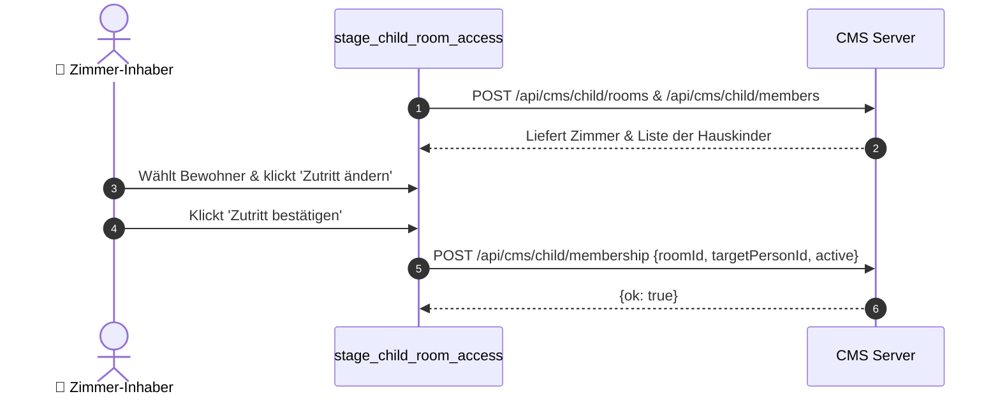

**Detaillierte Action-Beschreibung:**
- `Act_Zimmer_Laden` (*Typ: http*): Liest Zimmer via `POST /api/cms/child/rooms` aus.
- `Act_Zimmer_Mitglieder_Laden` (*Typ: http*): Ruft Bewohnerliste via `POST /api/cms/child/members` ab.
- `Act_Zutritt_Umschalten_Server` (*Typ: http*): Setzt Beziehungsstatus via `POST /api/cms/child/membership`.

---

### UC-06: Mehrspieler-Lobby & Einladungsversand
**Beschreibung:** Anwesende Mitspieler suchen, Spiel wählen und eine Mehrspielerpartie initiieren.

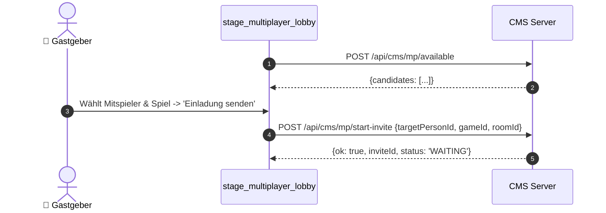

**Detaillierte Action-Beschreibung:**
- `Act_Lobby_Init` (*Typ: http*): Fragt verfügbare Spieler via `/api/cms/mp/available` ab.
- `Act_Einladung_Senden_Server` (*Typ: http*): Erzeugt Einladung via `POST /api/cms/mp/start-invite`.
- `Act_Partie_Beenden_Server` (*Typ: http*): Schließt die Sitzung mit `POST /api/cms/mp/end`.

---

### UC-07: Mehrspieler-Postfach & Spielbeitritt
**Beschreibung:** Empfangene Spieleinladungen verwalten, annehmen oder ablehnen.

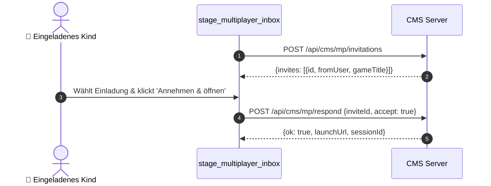

**Detaillierte Action-Beschreibung:**
- `Act_Inbox_Laden` (*Typ: http*): Ruft Einladungen via `POST /api/cms/mp/invitations` ab.
- `Act_Einladung_Antworten_Server` (*Typ: http*): Sendet Entscheidung über `POST /api/cms/mp/respond`.
- `Act_Teilnahme_Zurueckziehen_Server` (*Typ: http*): Zieht Zusage mit `POST /api/cms/mp/withdraw` zurück.

---
## Teil B: Eltern & Beobachter (Family Office)

### UC-08: Zentrale Verwaltungs-Authentifizierung
**Beschreibung:** Erwachsene melden sich mit Benutzername und Passwort an. Das CMS prüft das Passwort und fragt über `/api/cms/contexts` die Rollen ab, um die passenden Einstiegspunkte freizuschalten.

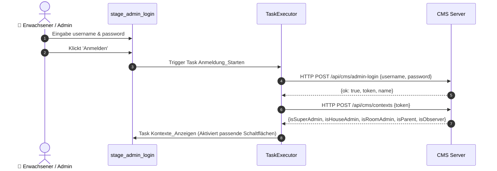

**Detaillierte Action-Beschreibung:**
- `Act_Admin_Anmeldung_Server` (*Typ: http*): Prüft Logindaten via `POST /api/cms/admin-login`.
- `Act_Sitzung_Lesen` (*Typ: http*): Fragt Berechtigungen über `POST /api/cms/contexts` ab.
- `Act_Sitzung_Anzeigen` (*Typ: property*): Schaltet Aktionsknöpfe (`Verwaltung öffnen`, `Meine Kinder öffnen`, `Beobachtung öffnen`) sichtbar.

---

### UC-09: Eltern-Aktivitätsmonitoring & 2-Stufen-Zeitbudget
**Beschreibung:** Eltern sehen Aktivitäten und Bewertungen ein und steuern das tägliche Zeitlimit mit verbindlicher 2-Stufen-Bestätigung.

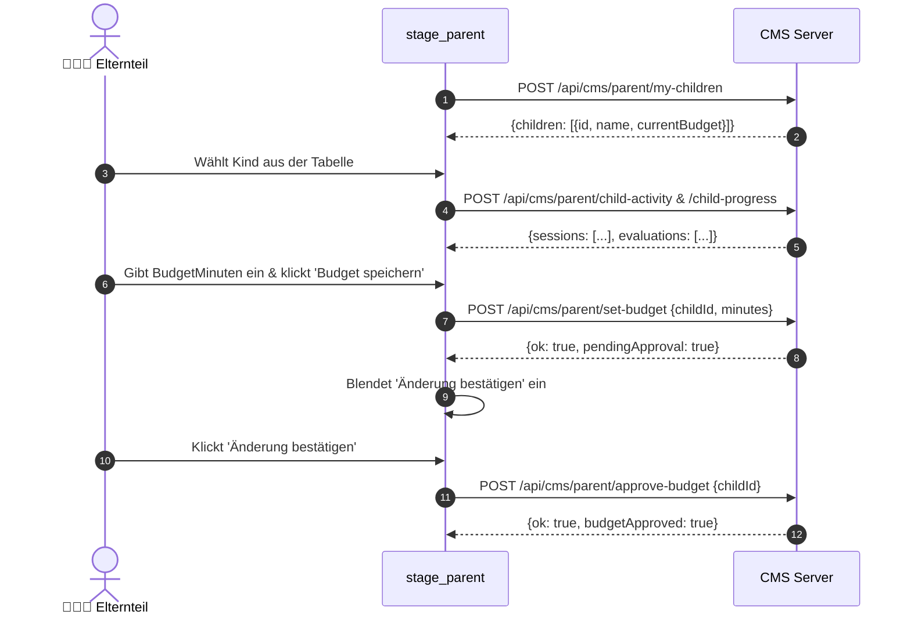

**Detaillierte Action-Beschreibung:**
- `Act_Kinder_Server` (*Typ: http*): Lädt verknüpfte Kinder via `POST /api/cms/parent/my-children`.
- `Act_Details_Server` (*Typ: http*): Ruft Historie via `POST /api/cms/parent/child-activity` ab.
- `Act_Budget_Server` (*Typ: http*): Reicht Budgetvorschlag via `POST /api/cms/parent/set-budget` ein.
- `Act_Bestaetigen_Server` (*Typ: http*): Schließt die Freigabe via `POST /api/cms/parent/approve-budget` ab.

---

### UC-10: Raum-Puls & Pädagogische Begleitung
**Beschreibung:** Beobachter und Betreuer verfolgen in Echtzeit die Aktivität und Belegung aller Räume.

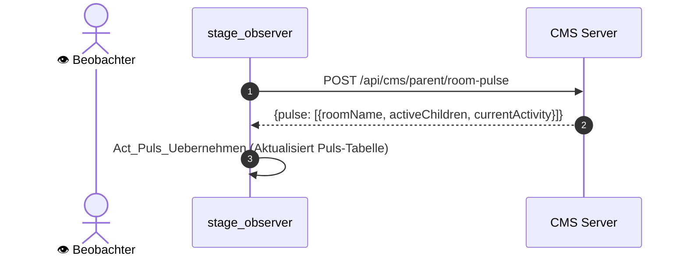

**Detaillierte Action-Beschreibung:**
- `Act_Puls_Server` (*Typ: http*): Ruft Raumauslastung via `POST /api/cms/parent/room-pulse` ab.
- `Act_Puls_Uebernehmen` (*Typ: call_method*): Schreibt Datenzeilen in `PulsTabelle`.

---

## Teil C: Raum-Administration (RaumAdmin)

### UC-11: Raum-Zutrittsverwaltung
**Beschreibung:** RaumAdmins steuern die Zutrittsberechtigung aller Hausbewohner für die von ihnen betreuten Räume.

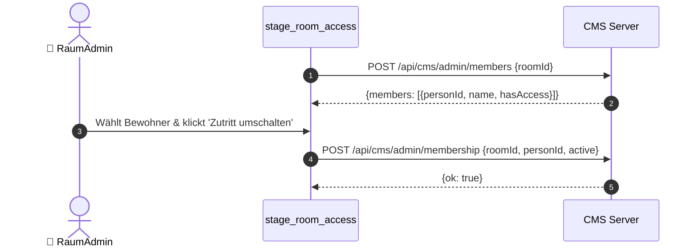

**Detaillierte Action-Beschreibung:**
- `Act_Mitglieder_Laden` (*Typ: http*): Sendet `POST /api/cms/admin/members` mit `roomId`.
- `Act_Zutritt_Umschalten` (*Typ: http*): Invertiert Zutritt via `POST /api/cms/admin/membership`.

---

### UC-12: Raum-Spielekatalog kuratieren
**Beschreibung:** Der RaumAdmin schaltet gezielt Spiele frei, die im Raum zur Verfügung stehen sollen.

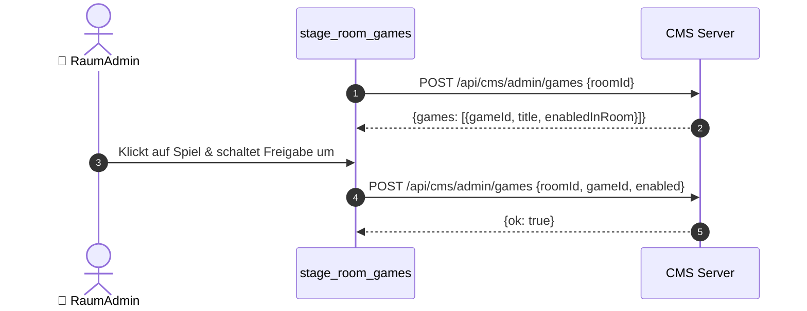

**Detaillierte Action-Beschreibung:**
- `Act_RaumSpiele_Laden` (*Typ: http*): Ruft Raumspiele via `POST /api/cms/admin/games` ab.
- `Act_RaumSpiel_Umschalten` (*Typ: http*): Aktualisiert Freigabeflag des Spiels.

---
## Teil D: Haus-Administration (HouseAdmin)

### UC-13: Raum-Lebenszyklus & RaumAdmin-Zuweisung
**Beschreibung:** Der HouseAdmin erstellt neue Räume, bearbeitet Metadaten und weist verantwortliche RaumAdmins zu.

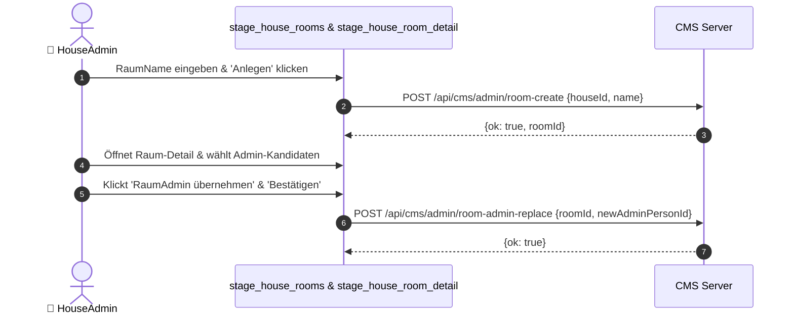

**Detaillierte Action-Beschreibung:**
- `Act_Raum_Anlegen` (*Typ: http*): Legt Raum mit `POST /api/cms/admin/room-create` an.
- `Act_RaumProfil_Speichern` (*Typ: http*): Sichert Stammdaten mit `POST /api/cms/admin/house-room-update`.
- `Act_RaumAdmin_Zuweisen_Server` (*Typ: http*): Überträgt Leitung via `POST /api/cms/admin/room-admin-replace`.

---

### UC-14: Raum-Sicherung & Wiederherstellung (Backup/Restore)
**Beschreibung:** Zur Risikominimierung können Raumeinstellungen und Mitgliederlisten als versionsgenauer Snapshot gesichert und wiederhergestellt werden.

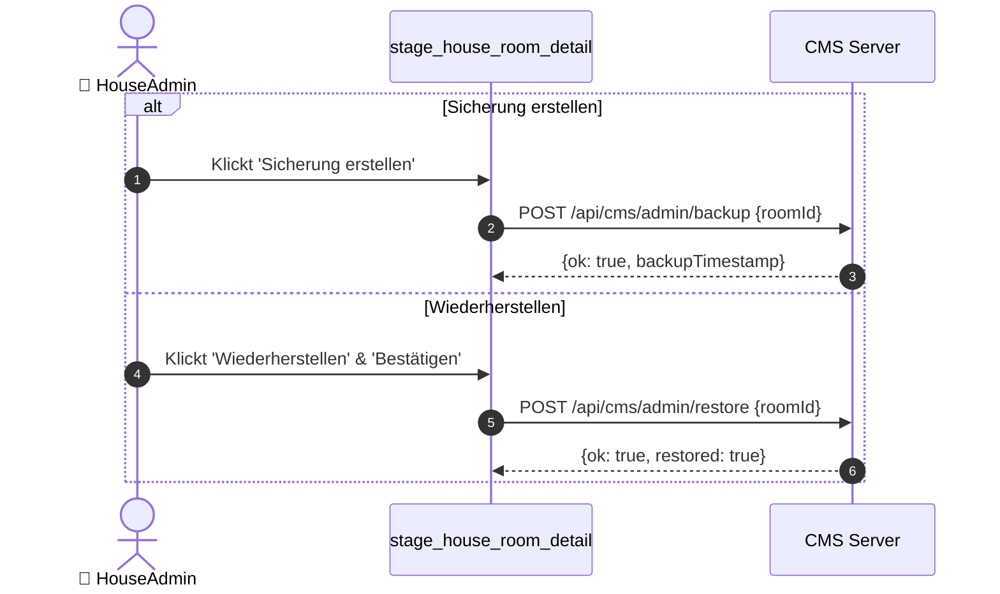

**Detaillierte Action-Beschreibung:**
- `Act_RaumBackup_Speichern` (*Typ: http*): Erzeugt Snapshot via `POST /api/cms/admin/backup`.
- `Act_RaumRestore_Server` (*Typ: http*): Rekonstruiert Snapshot via `POST /api/cms/admin/restore`.

---

### UC-15: Bewohner-Verwaltung & Emoji-PIN-Reset
**Beschreibung:** Anlegen neuer Bewohner sowie Vergabe und Rücksetzen von Emoji-PINs bei vergessenem Passwort.

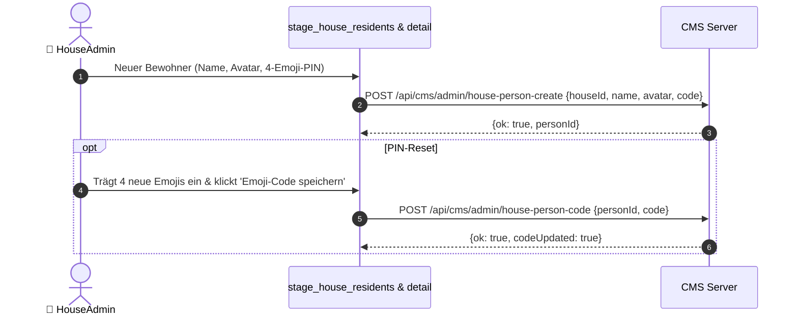

**Detaillierte Action-Beschreibung:**
- `Act_Bewohner_Anlegen` (*Typ: http*): Erstellt Person via `POST /api/cms/admin/house-person-create`.
- `Act_BewohnerCode_Speichern` (*Typ: http*): Überschreibt PIN via `POST /api/cms/admin/house-person-code`.

---

### UC-16: Familien-Verknüpfung (Eltern-Kind-Zuordnung)
**Beschreibung:** Verknüpfung von Erziehungsberechtigten mit Kindern zur Freischaltung des Eltern-Dashboards.

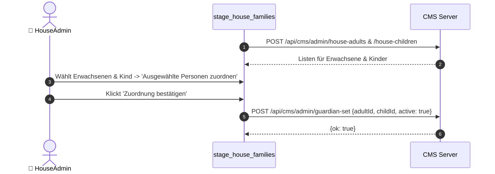

**Detaillierte Action-Beschreibung:**
- `Act_Erwachsene_Laden` & `Act_Kinder_Laden` (*Typ: http*): Ruft Bewohner nach Kategorie ab.
- `Act_Guardian_Set_Server` (*Typ: http*): Speichert Beziehung via `POST /api/cms/admin/guardian-set`.

---

### UC-17: Hausweiter Spielekatalog
**Beschreibung:** Der HouseAdmin aktiviert oder deaktiviert Plattformspiele für die gesamte Einrichtung.

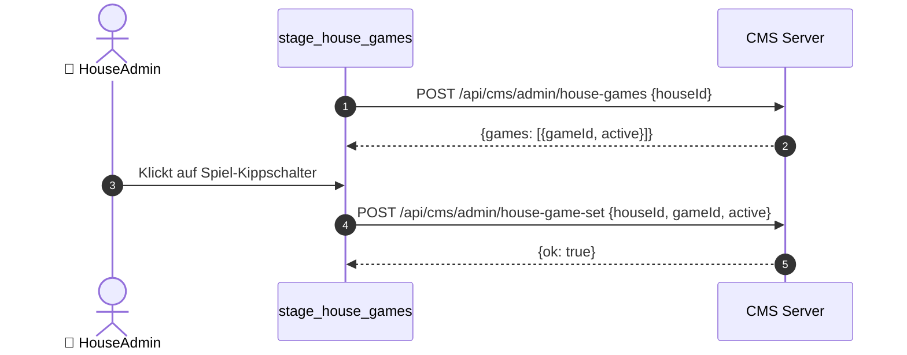

**Detaillierte Action-Beschreibung:**
- `Act_House_Games_Laden` (*Typ: http*): Sendet `POST /api/cms/admin/house-games`.
- `Act_House_Game_Set_Server` (*Typ: http*): Sendet Toggle via `POST /api/cms/admin/house-game-set`.

---

### UC-18: Einladungslinks für Eltern & Beobachter
**Beschreibung:** Ausstellung tokenisierter Einladungslinks zur Selbstregistrierung von Eltern und Beobachtern.

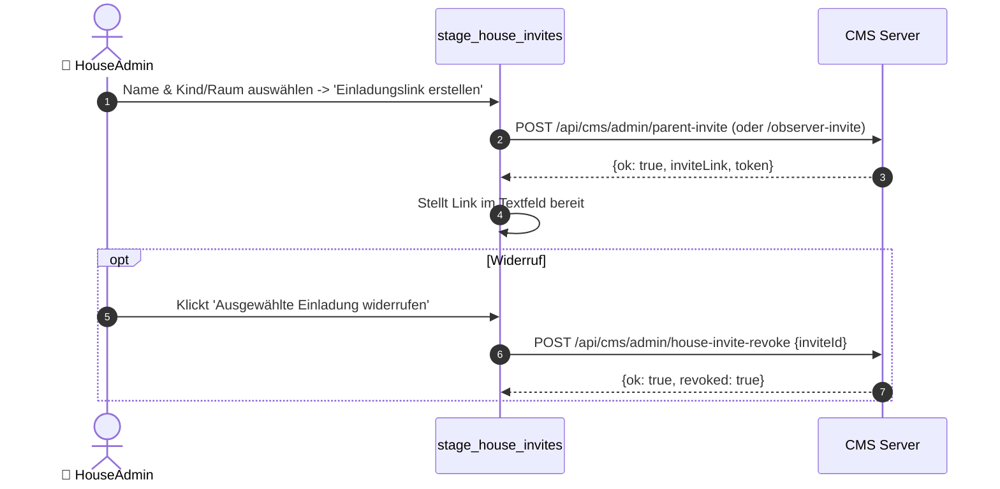

**Detaillierte Action-Beschreibung:**
- `Act_Eltern_Einladen_Server` (*Typ: http*): Erzeugt Elternlink via `POST /api/cms/admin/parent-invite`.
- `Act_Beobachter_Einladen_Server` (*Typ: http*): Erzeugt Beobachterlink via `POST /api/cms/admin/observer-invite`.
- `Act_Einladung_Widerrufen_Server` (*Typ: http*): Macht Token ungültig via `POST /api/cms/admin/house-invite-revoke`.

---
## Teil E: Plattform-Administration (SuperAdmin)

### UC-19: Spielhaus-Gründung & Plattformverwaltung
**Beschreibung:** SuperAdmins gründen neue Häuser, verwalten Stammdaten und erzeugen Registrierungslinks für Spieler.

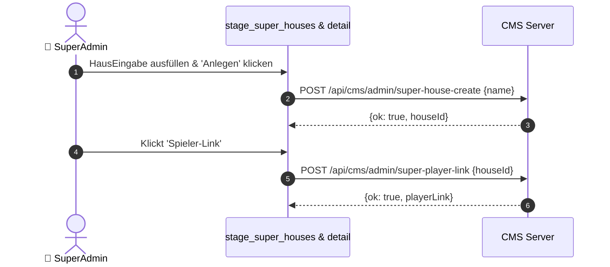

**Detaillierte Action-Beschreibung:**
- `Act_Super_House_Create` (*Typ: http*): Legt Haus via `POST /api/cms/admin/super-house-create` an.
- `Act_Super_Player_Link` (*Typ: http*): Generiert Einladungslink via `POST /api/cms/admin/super-player-link`.

---

### UC-20: Plattform- und Haus-Admins delegieren
**Beschreibung:** Verwaltung von Administrationskonten, Rollenzuweisung (SuperAdmin, HouseAdmin) und Kontosperrungen.

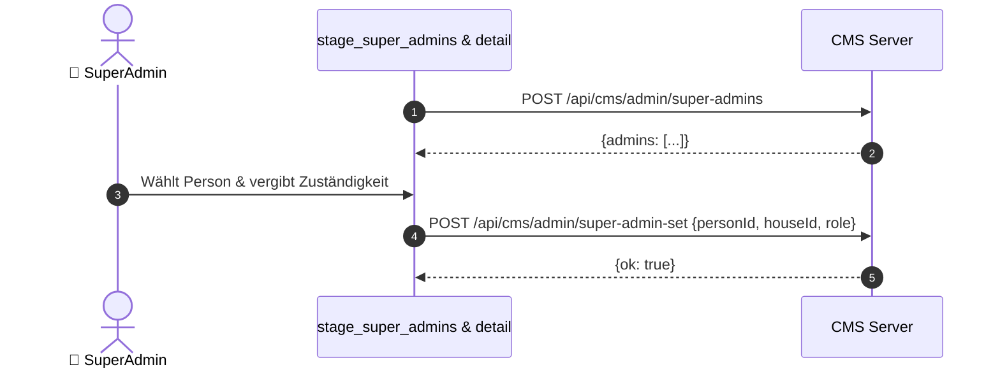

**Detaillierte Action-Beschreibung:**
- `Act_Super_Admins_Laden` (*Typ: http*): Liest Admins via `POST /api/cms/admin/super-admins`.
- `Act_Super_Admin_Set` (*Typ: http*): Aktualisiert Rollenstatus via `POST /api/cms/admin/super-admin-set`.

---

### UC-21: Spiele-Bibliothek & Paket-Upload
**Beschreibung:** Einstellen neuer Spielprojekte in die globale Bibliothek über Archivdateien (JSON oder ZIP) mit automatischer Versionierung.

```mermaid
sequenceDiagram
    autonumber
    actor SAdmin as 👑 SuperAdmin
    participant UI as stage_library & detail
    participant Srv as CMS Server

    SAdmin->>UI: SpielName eingeben & 'Spiel anlegen'
    UI->>Srv: POST /api/cms/admin/super-game-create {name}
    Srv-->>UI: {ok: true, gameId}
    SAdmin->>UI: Datei auswählen & '📤 Hochladen' klicken
    UI->>Srv: POST /api/cms/upload-library (multipart/form-data)
    Srv-->>UI: {ok: true, packageUrl, version: 1}
    SAdmin->>UI: '💾 Speichern'
    UI->>Srv: POST /api/cms/admin/super-game-update {gameId, title, desc, packageUrl}
    Srv-->>UI: {ok: true}
```

**Detaillierte Action-Beschreibung:**
- `Act_Super_Game_Create` (*Typ: http*): Erzeugt Spiel-Eintrag via `POST /api/cms/admin/super-game-create`.
- `Act_Game_Upload_Server` (*Typ: http / multipart*): Überträgt Archiv via `POST /api/cms/upload-library`.
- `Act_Super_Game_Update` (*Typ: http*): Sichert Metadaten via `POST /api/cms/admin/super-game-update`.

---

### UC-22: Sandbox-Prüfung, Freigabe-Workflow & Löschung
**Beschreibung:** Qualitätssicherung in isolierter Sandbox, Release für alle Häuser oder Rückzug als Entwurf sowie abgesicherte 2-Stufen-Löschung.

```mermaid
sequenceDiagram
    autonumber
    actor SAdmin as 👑 SuperAdmin
    participant UI as stage_library_detail
    participant Srv as CMS Server

    opt Sandbox-Prüfung
        SAdmin->>UI: Klickt '👁 Begutachten'
        UI->>UI: Startet isolierte Spiel-Vorschau in Test-Canvas
    end
    alt Veröffentlichen
        SAdmin->>UI: Klickt 'Veröffentlichen'
        UI->>Srv: POST /api/cms/admin/super-game-update {gameId, status: 'published'}
        Srv-->>UI: {ok: true, status: 'published'}
    else Als Entwurf zurückziehen
        SAdmin->>UI: Klickt 'Als Entwurf zurückziehen'
        UI->>Srv: POST /api/cms/admin/super-game-update {gameId, status: 'draft'}
        Srv-->>UI: {ok: true, status: 'draft'}
    else Endgültig löschen (2 Stufen)
        SAdmin->>UI: Klickt '🗑 Löschen'
        UI->>UI: Blendet Warnung & '⚠ Endgültig löschen' ein
        SAdmin->>UI: Klickt '⚠ Endgültig löschen'
        UI->>Srv: POST /api/cms/admin/super-game-delete {gameId}
        Srv-->>UI: {ok: true, deleted: true}
    end
```

**Detaillierte Action-Beschreibung:**
- `Act_Spiel_Begutachten` (*Typ: call_method*): Initialisiert temporären Standalone-Runner für Vorschau.
- `Act_Spiel_Veroeffentlichen` (*Typ: http*): Ändert Status auf `published` via `POST /api/cms/admin/super-game-update`.
- `Act_Spiel_Zurueckziehen` (*Typ: http*): Setzt Status auf `draft` via `POST /api/cms/admin/super-game-update`.
- `Act_Spiel_Loeschen_Server` (*Typ: http*): Entfernt Spiel und Instanzen via `POST /api/cms/admin/super-game-delete`.

---

*DV-Konzept Stand: Oktober 2026 · Game Creation Suite Architecture Review.*
